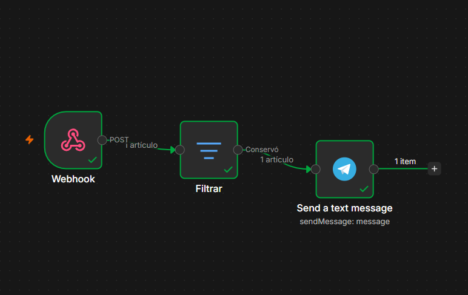

# 06 — Automatización y Notificaciones de Alertas

## 🤖 1. Propósito de la Automatización
Para reducir el tiempo de respuesta ante incidentes y evitar la supervisión manual constante del Dashboard, **RIOSEC** incorpora un sistema de automatización que procesa las alertas generadas por el SIEM (Wazuh) y las transmite en tiempo real hacia canales de mensajería instantánea.

---

## 🐍 2. Integración con la API de Wazuh (Python)
* **Consulta de Alertas:** Se desarrollan scripts en **Python** ubicados en la ruta de código del proyecto para interactuar directamente con la API REST de Wazuh.
* **Procesamiento:** Los scripts realizan consultas programadas o mediante webhooks para filtrar eventos según su nivel de severidad y extraer los campos críticos (origen, regla activada, usuario y host afectado).
## 📄 Código Fuente del Servicio (`riosec_api.py`):

```python
import sqlite3
from flask import Flask, jsonify

app = Flask(__name__)

@app.route("/agentes", methods=["GET"])
def obtener_agentes():
    db_path = "/var/ossec/queue/db/global.db"
    agentes_lista = []

    try:
        conn = sqlite3.connect(db_path)
        cursor = conn.cursor()

        # Consultamos únicamente ID y nombre que sabemos que existen seguros
        cursor.execute("SELECT id, name FROM agent")
        agentes = cursor.fetchall()

        for a in agentes:
            agentes_lista.append({
                "id": a[0],
                "name": a[1] or "N/A",
                "status": "active",  # Valor por defecto estandarizado para el laboratorio
            })

        conn.close()
        return jsonify({"status": "success", "agents": agentes_lista})

    except Exception as e:
        return jsonify({"status": "error", "message": str(e)}), 500

if __name__ == "__main__":
    app.run(host="0.0.0.0", port=5000)
```

---

## ⚡ 3. Orquestación con n8n
* **Flujo Sanitizado:** Se implementa un flujo de trabajo en **n8n** (exportado de forma segura en `n8n/riosec-alert-workflow-sanitized.json` sin credenciales sensibles).
* **Comportamiento del Flujo:** El orquestador recibe el evento procesado, formatea la estructura del mensaje de seguridad y lo canaliza de forma automatizada.



---

## 📲 4. Entrega de Alertas en Tiempo Real (Telegram)
* **Notificaciones Operativas:** El nodo final del flujo de n8n se comunica con la API de Bot de Telegram para enviar notificaciones inmediatas al analista.
* **Resultado:** Cada vez que Wazuh detecta un evento anómalo que cumple con los umbrales definidos, el sistema emite una alerta directa al dispositivo móvil con el contexto técnico del incidente.
